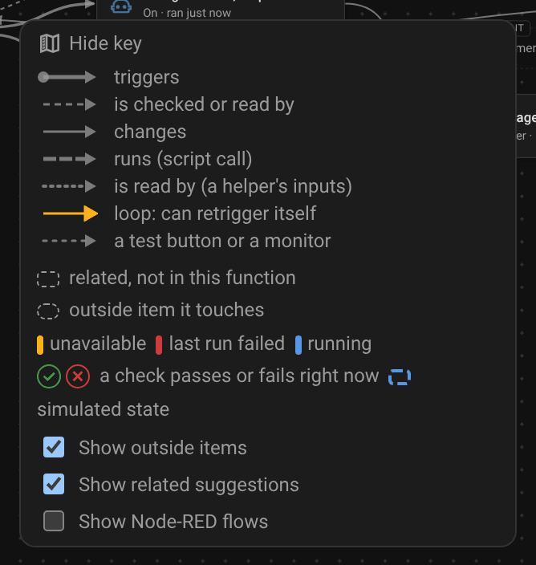
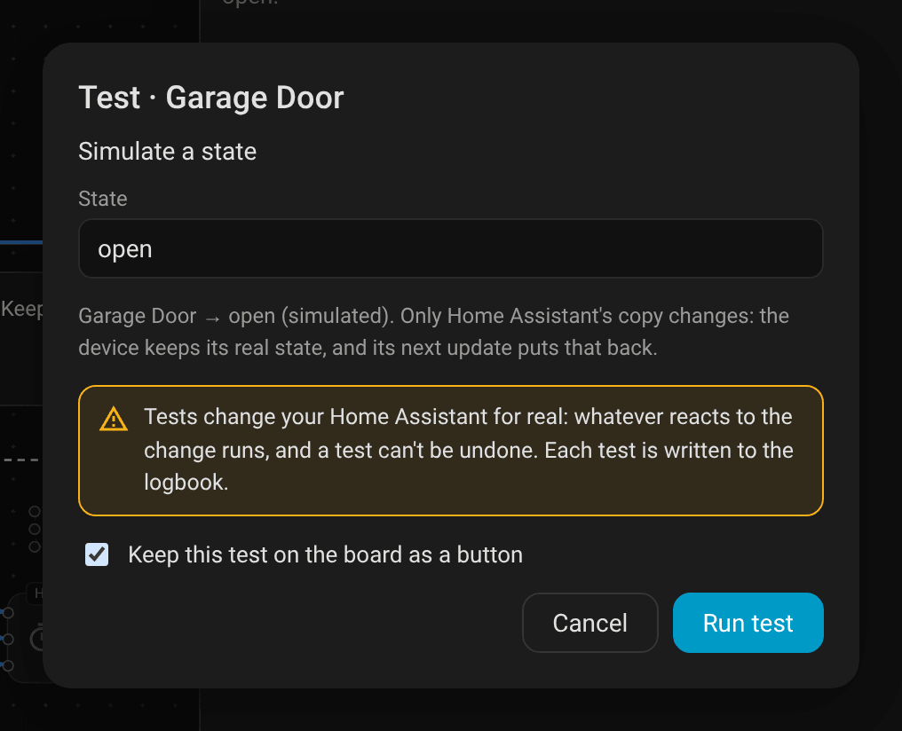
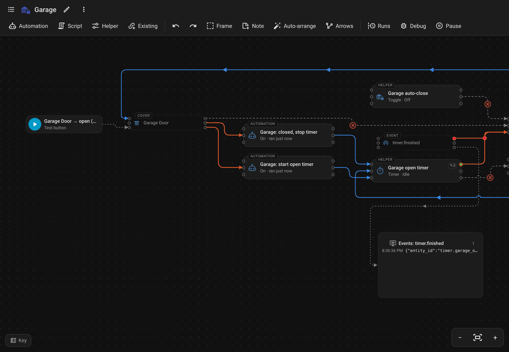
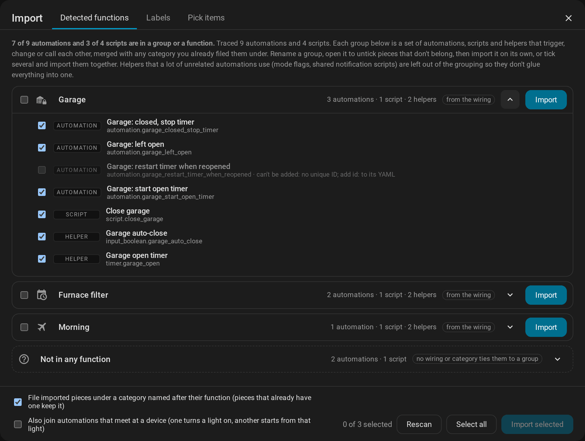

# Functions Board

A sidebar page for Home Assistant that shows each **function** in your home (the garage, the morning routine, the furnace filter) as one board: every automation, script, helper and device that makes it work, wired together from their own configs.


> **Prototype.** It runs on a real, busy setup, but expect rough edges. Issues and ideas are welcome.

## Why

Home Assistant files things by type: automations in one list, scripts in another, helpers in a third. A job in your home cuts across all of them, and after a while it gets hard to see what drives what. This started as a WTH ("What the heck?") post on the Home Assistant forum asking for a "functions" view.

## What you get

- **One board per function.** A function is a Home Assistant label. Everything carrying it is on the board, and still lives in its usual place under Settings.
- **Arrows read from your configs:** what triggers each automation, what it checks, what it changes and which scripts it runs, including area, floor and label targets, purpose-specific triggers (a light turning on, a door opening), what template and other derived helpers read, scenes and groups, and the buttons on a notification with the automations that answer them. Blueprint automations are read as Home Assistant fills them in. Real loops (an automation whose own effects can set it off again) are marked.
- **Laid out for you:** arrows are coloured by what they do (orange sets something off, blue changes it, aqua runs a script) and run square-cornered from left to right in their own lanes, never alongside each other, from three points on each side of a box. Lines that share a point branch at a dot, coloured per arrow to match the point at its other end; lines that cross without meeting hop over each other; arrows running back carry arrowheads along the way. Boxes line up with what they connect to, separate chains are packed together, and **Auto-arrange** lays out a function again at any time, and runs on every import; **Keep in place** in a box's bar leaves that box where you put it, and Undo puts your own arrangement back. **Arrows → Style → Curved arrows** brings back curved arrows.
- **Click a box** to light up its chain; the **Arrows** menu chooses how far (upstream, downstream, both) and which kinds of arrow show. **Edit** in a box's bar, or a double-click, opens it in Home Assistant's own editor without leaving the board: an automation's or script's editor, a helper's settings, a scene's editor.
- **Live:** states on every box, runs pulse as they happen, last-run failures and unavailable entities are flagged, and **Runs** lists every run in the function; picking one lights the arrows it actually used.
- **Import** finds the functions already in your setup. It traces every automation and script and groups the ones that trigger, change or call each other, merged with the categories you already use, and shows what is left over. Import them all or one at a time, start from labels you already have, or pick items by hand.
- **Build from the board:** new automations, scripts and helpers open in Home Assistant's editors and land in the function by themselves.
- **Frames and notes** to annotate a system, **Pause** to turn a function's automations off while you work on it, **Undo** for everything the board changes, and **Find** for anything in any function.
- **Developer tools:**
  - The **debugger** shows what happened in the function in the last 15 minutes and from then on, with what caused each step; picking a step lights the chain that led to it. Selecting an automation says why it did or didn't run, down to the condition that failed.
  - **Live checks** put a tick or a cross on each check arrow, and hovering an arrow that comes from a template shows its value now.
  - **Watch triggers** pulses an automation's trigger arrows whenever one would fire, without running it. With Pause, that's a dry run.
  - **Monitor boxes** list the last events of one type, or MQTT messages on a topic, while the function is open.
  - **Tests** (Full manager only) change a helper, simulate a state, fire an event, send a notification, or run an automation or script. A test can be kept on the board as a button.
- **Arrow editor** (Full manager only): drag from a box's dots (or from one box) onto another to add a trigger, a check, an action or a script call, chosen from Home Assistant's own lists. The YAML is shown and checked before it's saved. Click an arrow to remove what it stands for.
- **Node-RED flows** (off until you switch them on in the board's Key): each wired group in a flow is a box, with arrows to what it triggers on, reads, changes and runs.
- Works with the keyboard and screen readers, on a phone, and as a dashboard card. The board's text is kept in one table per language, so it can be translated (see [Translating](#translating)).

## A tour

The screenshots come from the demo setup the tests run on: a garage door that starts a timer, an automation that closes the door when the timer runs out while it's still open, and a furnace filter countdown.

**Click a box to follow its chain.** Everything it depends on and everything it sets off lights up, and its bar holds what you can do with it: edit it, see its traces, turn it off, test it, watch its triggers, keep it in place through Auto-arrange, or draw an arrow from it.


**The Arrows menu** chooses how far a selection lights up (its chain, upstream, downstream or both, up to a number of steps), which kinds of arrow show, square-cornered or curved arrows, and the live check marks.


<table>
<tr>
<td width="44%" valign="top"><b>The Key</b> says what each colour, line, dot, outline and mark means, and switches outside items, suggestions and Node-RED flows on and off.<br><br></td>
<td width="56%" valign="top"><b>A function's menu</b> renames it, hides it from the board, or deletes it, with or without its automations, scripts and helpers (Full manager).<br><br></td>
</tr>
</table>

### Debugging

**The debugger** lists what happened in the function, with what caused each step: here a test set the garage door to open, which ran "Garage: start open timer", which started the timer. Picking a row lights up the chain that led to it, one step at a time.


**Why didn't it run?** With the debugger open, selecting an automation lists its last runs and, for each one that stopped, the condition that failed and the value it saw.


### Testing

<table>
<tr>
<td width="45%" valign="top"><b>Test</b> any box from its bar (Full manager): change a helper, simulate a state, fire an event, run an automation. The dialog says what will happen before it does.<br><br></td>
<td width="55%" valign="top"><b>Draw an arrow</b> from one of a box's dots onto another box (Full manager): a right-hand dot draws an arrow out of the box, a left-hand one an arrow into it. Pick what it means from Home Assistant's own lists, see the YAML it adds, and save. Undo takes it back.<br><br></td>
</tr>
</table>

**Kept tests and monitors.** A test kept on the board is a button wired to what it tests. A monitor box lists the last events of one type, or the messages on an MQTT topic, while the function is open.



### Import, and on a phone

<table>
<tr>
<td width="70%" valign="top"><b>Import</b> finds the systems already in your setup, from how your automations and scripts are wired and the categories you already use.<br><br></td>
<td width="30%" valign="top"><b>On a phone</b> the board works the same. Swipe to move around; hold a box for a second to move it. In the phone app, Home Assistant's editors open full screen, and Back returns to the board.<br><br></td>
</tr>
</table>

## What it changes in your Home Assistant

Read this before installing. The integration starts in **Organise only** mode:

- Creating a function creates a **label**. When importing, it also files pieces that don't have a category under a **category** with the function's name (you can untick this).
- Adding or removing a piece adds or removes that label. Items keep their other labels and stay where they are.
- **Pause** and **Resume** turn the function's automations off and on.
- It **never edits or deletes** automations, scripts, helpers or devices. All editing happens in Home Assistant's own editors.

**Full manager**, an option in the integration's settings, also lets the board:

- **Delete** a function (its label and layout), a function together with its automations, scripts and helpers, or a single item, after a second step that lists what goes and what still uses it. Devices are never deleted.
- **Edit the wiring:** adding or removing an arrow rewrites that automation's or script's config the way Home Assistant's own editor does, so `automations.yaml` and `scripts.yaml` are rewritten and YAML comments in them are lost.
- **Run tests,** which change your home for real: whatever reacts to the change runs. The first test of a session asks first, and every test is written to the logbook.

Every change is shown before it happens, and **Undo** takes it back, except tests and deleting a helper that an integration set up.

In either mode:

- The debugger, Watch triggers, monitor boxes and the live checks on arrows only read. Watching a trigger never runs the automation.
- **Show Node-RED flows** reads your Node-RED app's flows in your browser, through the app's page in Home Assistant, only while it's switched on. That page opens to the board once you've opened Node-RED from the sidebar (or with the board's **Open Node-RED** button); until then the board shows the flows last read on any device, marked with when. The integration keeps that summary (group and tab names and the entity IDs they use, no flow code) so every board shares it. The board never signs itself in to the app.
- The board's own data (which labels are functions, box positions, frames, notes and test buttons) is kept in `.storage/functions_board` and shared between administrators. The Node-RED flow summary, when you use Node-RED flows, is kept in `.storage/functions_board.nodered`. Your view (zoom, whether the list is open) is kept per user.
- Nothing leaves your Home Assistant: no network calls, no external libraries, no telemetry.

Removing the integration takes the page out of the sidebar. Labels and categories stay; they are ordinary Home Assistant labels you can delete under **Settings → Areas, labels & zones → Labels**.

## Requirements

- Home Assistant **2026.11** or newer.
- An administrator account. The page only appears for administrators, because reading automation configs and changing labels needs admin rights.

## Install

### With the Marketplace

[](https://my.home-assistant.io/redirect/hacs_repository/?owner=ToolAndDieGuy&repository=functions-board&category=integration)

Or step by step:

1. Go to **Settings → Marketplace**, open **Add from link**, paste `https://github.com/ToolAndDieGuy/functions-board` and choose **Integration** as the type. Adding a link uses the Marketplace's GitHub connection; it asks you to connect if you haven't.
2. Open **Functions Board**, select **Install**, then restart Home Assistant when it asks.
3. Select **Set up**, or go to **Settings → Devices & services → Add integration → Functions Board**.

**Functions** now shows in the sidebar.

### Manually

Copy `custom_components/functions_board` into the `custom_components` folder of your configuration directory, restart Home Assistant, then add the integration as in step 3.

### Options

**Settings → Devices & services → Functions Board → Configure** chooses what the board may change (**Organise only** or **Full manager**) and whether the board is available as a dashboard card.

### First run

The page opens on a short welcome. **Import from my setup** lists the systems it found; open a group to untick pieces that don't belong, rename it, and import it. Or start a **New function** and build it from the board.

## As a dashboard card

Switch on **Make the Functions card available on dashboards** in the integration's options, then add a manual card:

```yaml
type: custom:functions-board
```

It needs room, so a **panel** view works best. Without the option, a dashboard resource still works: **Settings → Dashboards → ⋮ → Resources**, the URL `/functions_board_static/functions-board.js` as a JavaScript module.

## How the arrows are worked out

Each automation and script config is read for:

| Arrow | Colour | Comes from |
| --- | --- | --- |
| triggers | orange | state, numeric state, event, MQTT, device and purpose-specific triggers (`light.turned_on`, `door.opened`...) |
| is checked or read by | grey, dashed | conditions, and entities named in templates |
| changes | blue | the targets of actions (entities, devices, areas, floors and labels), and the members of a scene or group |
| runs | aqua | script calls |
| is read by | grey, dotted | what template helpers, trigger-based template sensors and other derived helpers (min/max, threshold, utility meter...) read |

A **loop** (an amber glow round the arrow) means an automation's or script's own effects can set it off again, like an automation that toggles the light it is triggered by. Effects that can't fire a trigger don't count: closing a door won't fire a trigger on it opening, cancelling a timer won't fire `timer.finished`, turning a light off won't fire a trigger on its brightness, and setting the state that triggered an automation changes nothing.

Node-RED flows are read when you switch them on: each wired group is a box, with arrows to the entities its nodes trigger on, read and change, and the scripts they run.

Not followed yet: AppDaemon, pyscript and other code outside Home Assistant's own automations and scripts.

## Translating

Every text the board shows is in one table near the end of the board's library section in `frontend/functions-board.js`: `STR.en`, keyed by id. A translation is one more table with the same ids, named like Home Assistant's language codes (`STR.de`, `STR['pt-BR']`); ids it leaves out stay English, and `pt-BR` falls back to `pt` before English. Keep the `{placeholders}`, and give counts the plural forms your language has (`one`, `few`, `many`, `other`...).

To try a table without editing the file, add it from the browser console on the Functions page, for example `customElements.get('functions-board').STR.de = { automation: 'Automatisierung' }`. The board switches to it at its next update when your profile's language is German.

## Feedback

This is a prototype (v0.6.2). Please open an [issue](https://github.com/ToolAndDieGuy/functions-board/issues) for bugs, wrong or missing arrows, or ideas. A screenshot of the board and the automation's YAML help a lot.

## Credits

- **Design and concept:** [ToolAndDieGuy](https://github.com/ToolAndDieGuy): the idea of a functions view, from the WTH post on, and how a function should look and work.
- **Build:** Claude Opus 5.5, Anthropic's AI model, with advice from Claude Fable 5.2: the code, the tests and this documentation, from those plans, checked on a live Home Assistant along the way.

## License

[MIT](LICENSE)


Tool and Die Guy Here- I am not a coder, nor do I have any software experience. I had an idea for how Home Assistants various components should be organized and managed and I used Claude to make it real. I can't answer any questions about the code. I guided Claude through designing this. That's it. the documentation, testing, deployment, debugging, etc has all been Claude. This paragraph is the only thing I have personally typed. If the developers of Home Assistant are interested in this, they can have this project freely.
