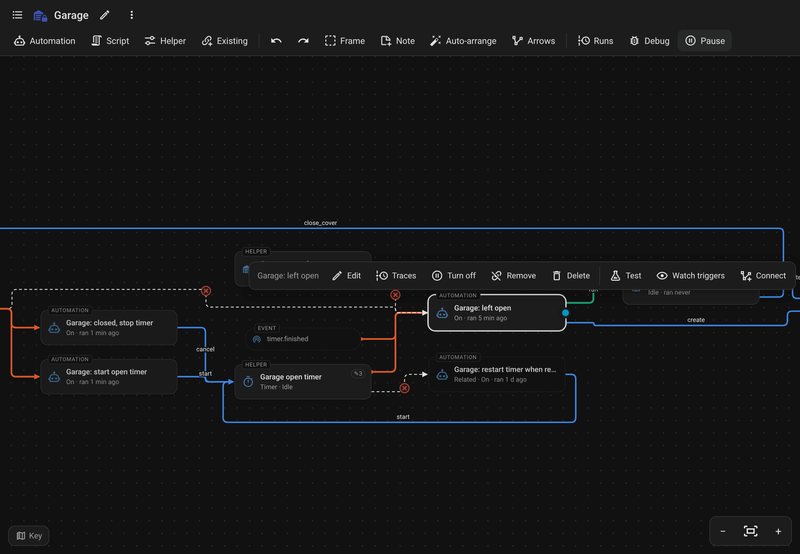
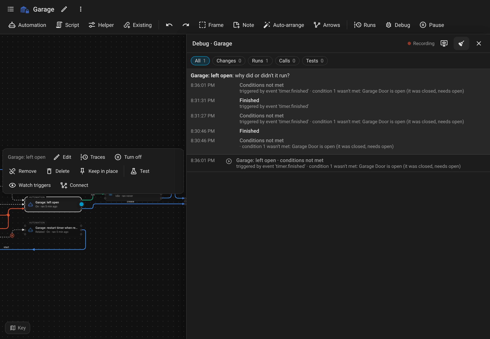
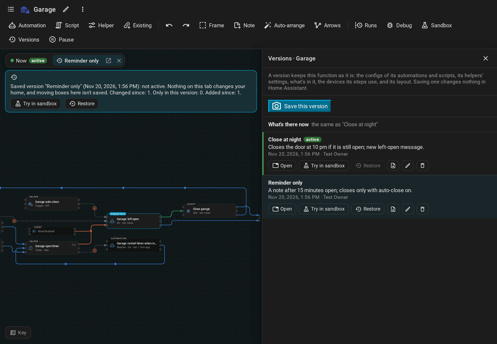

# Functions Board

Every job your Home Assistant does (the garage, the bedtime routine, the furnace filter) is spread across
automations, scripts, helpers and devices, each in its own list. Functions Board puts each job on one board, wired
together from their own configs. Then it does what Home Assistant can't: it shows you what's broken, lets you try a
change without touching your home, and keeps versions you can go back to.

## What it does

- **See a job whole.** Every automation, script, helper and device behind it on one board, with arrows for what
  triggers, checks, changes and runs what. Import finds the systems you've already built, from how they're wired and
  the categories you already use.
- **Find what's broken.** Rename an entity and every automation that used it quietly stops working. Home Assistant
  doesn't say; the board does. Ask why an automation didn't run and it shows the condition that failed and the value
  it saw.
- **Try it without touching your home.** The [sandbox](docs/sandbox.md) runs a function on a copy of your states,
  with its own clock: open the door, skip ahead 15 minutes, watch it close. Press a remote's buttons, report a
  Z-Wave lock's state, or replay last night from your history and see how it compares with what really happened.
- **Keep it working.** Save a sandbox run as a check: it's replayed after every change to the function, and turns
  red if it stops passing. Save versions of a function, open one beside what's there now, and make an old one
  active again.
- **Build from recipes.** The notification builder writes an ordinary Home Assistant script: who gets it, how
  urgent it is, quiet hours, and buttons that do things.

There's more (a debugger with what caused each step, live checks on the arrows, tests, drawing an arrow to add a
trigger or an action): [the guide](docs/guide.md) has all of it.

## It's still Home Assistant

Nothing new runs your home. Your automations stay ordinary Home Assistant automations, scripts and helpers, where
they've always been: the board reads them and opens Home Assistant's own editors. Out of the box it only adds
labels, so a function is a label. Take the board out and everything keeps running. Nothing leaves your Home
Assistant.

## Install

You need Home Assistant **2026.11** or newer and an administrator account (the page only appears for
administrators, because reading automation configs and changing labels needs admin rights).

### With the Marketplace

Or step by step:

1. Go to **Settings → Marketplace**, open **Add from link**, paste `https://github.com/ToolAndDieGuy/functions-board` and choose **Integration** as the type. Adding a link uses the Marketplace's GitHub connection; it asks you to connect if you haven't.
2. Open **Functions Board**, select **Install**, then restart Home Assistant when it asks.
3. Select **Set up**, or go to **Settings → Devices & services → Add integration → Functions Board**.

**Functions** now shows in the sidebar.

### Manually

Copy `custom_components/functions_board` into the `custom_components` folder of your configuration directory, restart Home Assistant, then add the integration as in step 3.

### Options

**Settings → Devices & services → Functions Board → Configure** chooses what the board may change (**Organise only** or **Full manager**) and whether the board is available as a dashboard card.

### First run

The page opens on a short welcome. **Import from my setup** lists the systems it found; open a group to untick pieces that don't belong, rename it, merge it with another (the import offers where two may be one system, and says why) or separate it again, and import it. Or start a **New function** and build it from the board.

## A quick tour

**One board per job.** The garage door starts a timer; the timer finishing runs "Garage: left open", which checks
auto-close and calls the "Close garage" script. Orange arrows set things off, blue ones change things, aqua ones
run a script, and the crosses are checks that fail right now.

**Click a box to follow its chain.** Everything it depends on and everything it sets off lights up, and its bar
holds what you can do with it, starting with **Edit** in Home Assistant's own editor.

**Why didn't it run?** With the debugger open, selecting an automation lists its last runs and, for each one that
stopped, the condition that failed and the value it saw.

**Versions.** Save a function before you change it, open a saved version in a tab beside what's there now, try it in
the sandbox, and make it active again.

More in [the guide](docs/guide.md): problems, testing, top-to-bottom layout, notifications, import, the phone and the
dashboard card.

## What it changes in your Home Assistant

The integration starts in **Organise only** mode. Creating a function creates a label (and, when importing, files
pieces with no category under one with the function's name); adding or removing a piece adds or removes that label;
**Pause** turns the function's automations off and on. It never edits or deletes automations, scripts, helpers or
devices.

**Full manager**, an option in the integration's settings, also lets the board delete things, edit the wiring, run
tests that change your home for real, make a saved version active, and save what the notification builder makes,
always through Home Assistant's own APIs. Every change is shown before it happens, and **Undo** takes it back,
except tests and deleting a helper that an integration set up.

In either mode, the sandbox, the debugger and the problems check only read. The full list:
[what it changes, and privacy](docs/what-it-changes.md).

## Privacy

The board talks to your Home Assistant and nothing else, and what it keeps stays in Home Assistant's own storage. It
has no network code of its own, adds no outside Python libraries (it uses only what comes with Home Assistant) and sends no telemetry. Every push runs checks that hold
it to that, each shown to fail when its rule is broken: [how](docs/what-it-changes.md#privacy).

## Questions

**Is this like Node-RED?** It looks a bit like it, boxes and arrows, but it does a different job. Node-RED is an
automation engine: your logic lives in its flows, and its wires carry messages. The board runs nothing; its arrows
are what it reads from Home Assistant's own automations and scripts. If you use Node-RED as well, the board can show
your flows beside the rest of a function. [More](docs/guide.md#node-red).

**What if I take it out?** The page leaves the sidebar and your automations keep running as before. The labels it
made stay, as ordinary labels you can delete under **Settings → Areas, labels & zones → Labels**.

**Does the sandbox change anything?** No. It reads (your states, and what it needs to know about your devices) and
asks Home Assistant to render templates. It never calls a service, fires an event or sets a state.

**Does it work on a phone, or with a keyboard or a screen reader?** Yes to all three, and as a dashboard card:
[accessibility](docs/guide.md#accessibility), [the card](docs/guide.md#as-a-dashboard-card).

## Feedback

This is an early release (v0.13.1), and what would help most is hearing how it does in a real home:

- What did **Import** get right or wrong about your setup?
- Did the board show something you didn't know about your own automations (a problem, a loop, a reason one didn't
  run)?
- What did you try in the sandbox, and what couldn't it do?

[First impressions](https://github.com/ToolAndDieGuy/functions-board/issues/new?template=impressions.yml) takes a
minute and needs nothing from your setup. For questions and chat, there are
[Discussions](https://github.com/ToolAndDieGuy/functions-board/discussions). For bugs and wrong or missing arrows,
open an [issue](https://github.com/ToolAndDieGuy/functions-board/issues/new/choose): a screenshot and the
automation's YAML help a lot, and so does a diagnostics file (anonymised is fine).

## Credits

- **Design and concept:** [ToolAndDieGuy](https://github.com/ToolAndDieGuy): the idea of a functions view, from the WTH post on, and how a function should look and work.
- **Build:** Claude Opus 5.5, Anthropic's AI model, with advice from Claude Fable 5.2: the code, the tests and this documentation, from those plans, checked on a live Home Assistant along the way.

## License

[MIT](LICENSE)

Tool and Die Guy Here- I am not a coder, nor do I have any software experience. I had an idea for how Home Assistants various components should be organized and managed and I used Claude to make it real. I can't answer any questions about the code. I guided Claude through designing this. That's it. the documentation, testing, deployment, debugging, etc has all been Claude. This paragraph is the only thing I have personally typed. If the developers of Home Assistant are interested in this, they can have this project freely.
