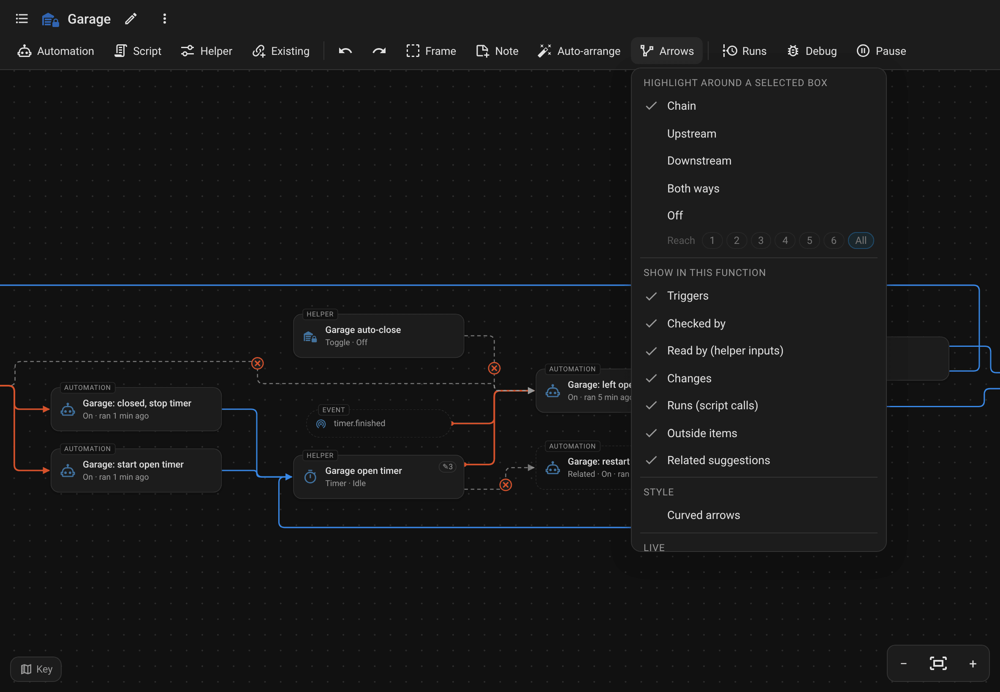
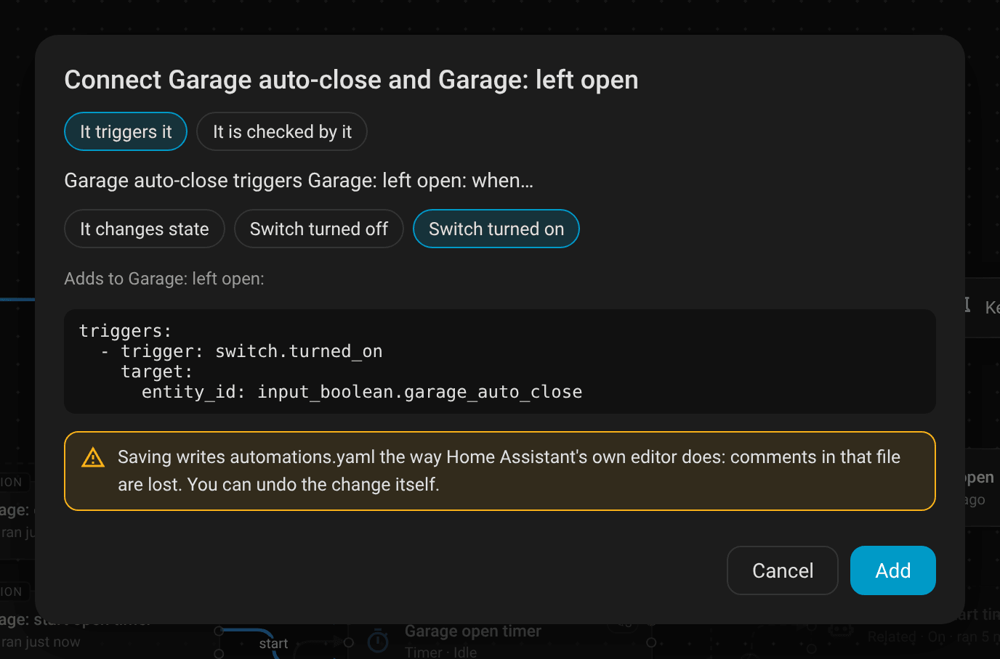

# Functions Board

A sidebar page for Home Assistant that shows each **function** in your home (the garage, the morning routine, the furnace filter) as one board: every automation, script, helper and device that makes it work, wired together from their own configs.


> **Prototype.** It runs on a real, busy setup, but expect rough edges. Issues and ideas are welcome.

## Why

Home Assistant files things by type: automations in one list, scripts in another, helpers in a third. A job in your home cuts across all of them, and after a while it gets hard to see what drives what. This started as a WTH ("What the heck?") post on the Home Assistant forum asking for a "functions" view.

## How it's different from Node-RED

At a glance the board looks like Node-RED: boxes joined by arrows. It does a different job.

**Node-RED is an automation engine with its own editor.** Your logic lives in its flows and runs inside Node-RED, built largely from Node-RED's own nodes. The wires are the logic: a message travels along them from node to node.

**The board is a management layer for what's already native to Home Assistant:** automations, scripts, helpers, scenes and devices. It holds no logic of its own and runs nothing. The arrows aren't wires that carry anything. They're the dependencies the board reads from your configs: what sets each automation off, what it checks, what it changes, and which scripts it calls.

Say one job in your home takes 4 automations, 7 helpers, a scene and 3 scripts. In Home Assistant they're spread across four different lists, and nothing shows how they work together. The board puts them on one screen as the connected system they are, and you can edit all of them from there.

| | Node-RED | Functions Board |
|---|---|---|
| Where the logic lives | in Node-RED's flows | in Home Assistant's own automations and scripts, as before |
| What an arrow means | a wire: messages travel along it | a dependency read from a config: triggers, checks, changes, script calls |
| What runs your automations | Node-RED | Home Assistant, as before; the board runs nothing on its own |
| Editing | Node-RED's editor | Home Assistant's own editors, opened from the board, plus drawing a trigger, check or call as an arrow (Full manager) |
| What it adds | another way to build automations | one view per job, with tracing, debugging, problems, a sandbox, saved checks and versions |
| Taking it out | the flows stop | your automations keep running: everything stays where it always was, the labels the board added included |

The two get along. If you use Node-RED as well, the board can show your flows next to the rest of a function (switch **Node-RED flows** on in the Key). Each wired group is a box, with arrows to what it triggers on, reads, changes and runs, so a job that's half automations and half flows is still on one board.

## What you get

- **One board per function.** A function is a Home Assistant label. Everything carrying it is on the board, and still lives in its usual place under Settings.
- **Arrows read from your configs:** what triggers each automation, what it checks, what it changes and which scripts it runs, including area, floor and label targets, purpose-specific triggers (a light turning on, a door opening), what template and other derived helpers read, scenes and groups, and the buttons on a notification with the automations that answer them. Blueprint automations are read as Home Assistant fills them in. Real loops (an automation whose own effects can set it off again) are marked.
- **Laid out for you:** arrows are coloured by what they do (orange sets something off, blue changes it, aqua runs a script) and run square-cornered from left to right in their own lanes, never alongside each other, from three points on each side of a box. Lines that share a point branch off it at a dot; point at a box (or select it) and its arrows are traced end to end through the shared line while the others fade; lines that cross without meeting hop over each other; arrows running back carry arrowheads along the way. A function flows left to right, or top to bottom if you choose. Boxes line up with what they connect to, separate chains are packed together, and **Auto-arrange** lays out a function again at any time, and runs on every import; **Keep in place** in a box's bar leaves that box where you put it, and Undo puts your own arrangement back. **Arrows → Style → Curved arrows** brings back curved arrows.
- **Click a box** to light up its chain; the **Arrows** menu chooses how far (upstream, downstream, both) and which kinds of arrow show. **Edit** in a box's bar, or a double-click, opens it in Home Assistant's own editor without leaving the board: an automation's or script's editor, a helper's settings, a scene's editor.
- **Live:** states on every box, runs pulse as they happen, last-run failures and unavailable entities are flagged, and **Runs** lists every run in the function; picking one lights the arrows it actually used.
- **Import** finds the functions already in your setup. It traces every automation and script (and your Node-RED flows, while the board reads them) and groups the ones that trigger, change or call each other, start from the same device, or are named as one system, with the categories you already use, and shows what is left over. Where two groups may be one system it offers to merge them and says why; a merged group shows what it's made from and can be separated again, so you decide where one system ends. Import them all or one at a time, start from labels you already have, or pick items by hand.
- **Build from the board:** new automations, scripts and helpers open in Home Assistant's editors and land in the function by themselves.
- **Frames and notes** to annotate a system, **Pause** to turn a function's automations off while you work on it, **Undo** for everything the board changes, and **Find** for anything in any function.
- **Developer tools:**
  - The **debugger** shows what happened in the function in the last 15 minutes and from then on, with what caused each step; picking a step lights the chain that led to it. Selecting an automation says why it did or didn't run, down to the condition that failed.
  - **Live checks** put a tick or a cross on each check arrow, and hovering an arrow that comes from a template shows its value now.
  - **Watch triggers** pulses an automation's trigger arrows whenever one would fire, without running it. With Pause, that's a dry run.
  - **Monitor boxes** list the last events of one type, or MQTT messages on a topic, while the function is open.
  - The **sandbox** runs the function on a copy of its states, with its own clock: set a state, fire an event or run an automation, and watch what the function would do played on the board step by step, without anything changing in your home. Works in either mode.
  - **Saved checks:** keep a sandbox run, with what should come of it, as a check that's replayed after every change to the function. If it stops passing, it shows up as a problem.
  - **Tests** (Full manager only) change a helper, simulate a state, fire an event, send a notification, or run an automation or script. A test can be kept on the board as a button.
- **Problems:** the board finds what each function's automations and scripts point at that isn't there or can't work (an entity renamed or removed, a device or area that's gone, an action whose integration isn't set up), counts them on the list and marks them on the board. Home Assistant itself doesn't warn about these.
- **Versions:** save a function as it is, with a name and a description, open a saved version in a tab beside what's there now, try it in the sandbox, and restore it (Full manager).
- **Arrow editor** (Full manager only): drag from a box's dots (or from one box) onto another to add a trigger, a check, an action or a script call, chosen from Home Assistant's own lists. The YAML is shown and checked before it's saved. Click an arrow to remove what it stands for.
- **Node-RED flows** (off until you switch them on in the board's Key): each wired group in a flow is a box, with arrows to what it triggers on, reads, changes and runs.
- Works with the keyboard and screen readers, on a phone, and as a dashboard card. The board's text is kept in one table per language, so it can be translated (see [Translating](#translating)).

## A tour

The screenshots come from the demo setup the tests run on: a garage door that starts a timer, an automation that closes the door when the timer runs out while it's still open, and a furnace filter countdown.

**Click a box to follow its chain.** Everything it depends on and everything it sets off lights up, and its bar holds what you can do with it: edit it, see its traces, turn it off, test it, watch its triggers, keep it in place through Auto-arrange, or draw an arrow from it.


**The Arrows menu** chooses how far a selection lights up (its chain, upstream, downstream or both, up to a number of steps), which kinds of arrow show, square-cornered or curved arrows, and the live check marks.



<table>
<tr>
<td width="44%" valign="top"><b>The Key</b> says what each colour, line, dot, outline and mark means, and switches outside items, suggestions and Node-RED flows on and off.<br><br></td>
<td width="56%" valign="top"><b>A function's menu</b> renames it, hides it from the board, or deletes it, with or without its automations, scripts and helpers (Full manager).<br><br></td>
</tr>
</table>

### Debugging

**The debugger** lists what happened in the function, with what caused each step: here a test set the garage door to open, which ran "Garage: start open timer", which started the timer. Picking a row lights up the chain that led to it, one step at a time.


**Why didn't it run?** With the debugger open, selecting an automation lists its last runs and, for each one that stopped, the condition that failed and the value it saw.


### Problems

Rename or remove an entity, and Home Assistant leaves every automation that used it pointing at nothing. Nothing warns you; the automation just stops doing its job. The board checks what each function's automations and scripts point at:

- **Red** stops something working: an entity that doesn't exist (renamed or removed?), one no integration provides any more, a device, area, floor or label that's gone, an action whose integration isn't set up, an automation that couldn't be set up.
- **Amber** may be on purpose: something unavailable or disabled, an automation that's turned off (not while the function is paused).

Each function in the list shows how many it has, the header's **problems** chip opens the list (what each one is in, **Show** it on the board, **Edit** the automation), and the boxes and arrows involved are marked. It only reads, and it keeps up as states and configs change.

A problem you know about (a device that's unplugged for the winter) can be **dismissed**: it leaves the count, the list's badge and the marks on the board, and goes under **Dismissed** in the header, where **Bring back** returns it. Dismissals are kept with the function and shared between administrators. One is forgotten once its problem has been gone for a day, so if the problem comes back later, it shows again.

### Testing

<table>
<tr>
<td width="45%" valign="top"><b>Test</b> any box from its bar (Full manager): change a helper, simulate a state, fire an event, run an automation. The dialog says what will happen before it does.<br><br></td>
<td width="55%" valign="top"><b>Draw an arrow</b> from one of a box's dots onto another box (Full manager): a right-hand dot draws an arrow out of the box, a left-hand one an arrow into it. Pick what it means from Home Assistant's own lists, see the YAML it adds, and save. Undo takes it back.<br><br></td>
</tr>
</table>

**Kept tests and monitors.** A test kept on the board is a button wired to what it tests. A monitor box lists the last events of one type, or the messages on an MQTT topic, while the function is open.


### Top to bottom

The **Auto-arrange** button's menu sets which way a function flows: **left to right** (the default) or **top to bottom**, like a sequential function chart: what sets things off at the top, arrows leaving each box by its bottom edge and entering the next by its top. Each function keeps its own direction. Switching lays the whole function out again and lets go of boxes kept in place (Undo puts it all back). A row that would get too wide wraps: inputs move up a row and end points down a row, so a script that drives thirty things doesn't make one row thirty boxes wide. The arrows follow the same rules both ways: never closer than 16 px, never through a box, a hop at every crossing.


### Sandbox

**Sandbox** (in the function's toolbar) tries the function out on a copy of its states. Each time it opens, a dialog explains what it's for and everything it can't show you, to click through. Set a state, fire an event or run an automation (each picked from a list of what fits the function, with Other… for anything else), and the board shows what the function would do: what triggers, which conditions pass and why, what each action changes, and what that sets off next, lit up on the board and listed in the drawer. Nothing is sent to your devices, and the board goes back to your home's states when you close it.


- **Its own clock.** Delays, timers, `for:` durations, time triggers and time patterns run on the sandbox clock: **+1 min**, **+10 min**, **+1 h**, or **Next** to jump to the next thing due. "Left open for 15 minutes, then close it" takes a click.
- **Templates are real.** Home Assistant renders each template the way it would in a real run, but `states()`, `is_state()`, `state_attr()`, `states.x.y`, `states[...]`, `states | ...`, `expand()`, `now()` and the like read the sandbox's states and clock. A template that reads locations (`closest()`, `distance()`) is marked *partly real*.
- **It asks what it can't know**: a sun, zone or device condition, or a template Home Assistant couldn't render. Your answer is used for that step.
- **What it follows:** state, numeric state, event, MQTT, time, time pattern and template triggers (with `for:`), and Home Assistant's per-entity triggers (`light.turned_on`, `door.opened`, `lock.unlocked`, `event.received`, thresholds and the rest), by the same rules as Home Assistant's own; state, numeric state, template, time, trigger, and/or/not conditions; service calls on helpers, lights, switches, covers, locks, climate, timers, counters, selects and more, and `mqtt.publish`; scripts, `choose`, `if`, `repeat`, `parallel`, `variables`, `wait_template`, `wait_for_trigger` (any of those triggers), `stop`, and the run modes (single, restart, queued, parallel). Notifications, TTS and log messages are listed as messages; any other call it doesn't know the effect of is listed as one it would make. A change that sets off more than 2,000 steps is stopped as a loop.
- **Triggers it can't follow** (zone, sun, Home Assistant starting, webhooks, device triggers) are named when it opens. **Run** an automation as if any one of its triggers fired, so `trigger.id` conditions and `trigger.` templates work. An **MQTT** row sends a message on a topic the function listens to.
- Only the automations and scripts on the board run in the sandbox. Test buttons and the Test dialog act on the sandbox while it's open.
- **Follow it on the board.** Whatever you do is played on the board step by step: each step's arrow lights with a dot running along it and a number beside it, conditions show ✓ or ✕ on their arrows, and what isn't on the board (the event a run stood in for, a sensor it checked, the MQTT topic a script publishes to) gets a temporary dashed box beside what it touches. A box with a delay running shows how long is left. Step with ◀ ▶ in the bar under the board, or click a row in the drawer.

**Saved checks.** After doing something in the sandbox, **Save as a check** keeps the steps, the states and the time they started from, and what came of it (you tick which: the door ends closed, "Close garage" runs to the end, an automation is stopped by its conditions or doesn't run). The board replays every check on the function's current configs when they change and when you open it; a check that stops passing is a red problem saying what happened instead, and **Replay** plays it in the sandbox, step by step. It's a regression test for a part of your home, and like the sandbox it never touches your devices.

### Versions

**Versions** (in the function's toolbar) keeps named snapshots of a function: the configs of its automations and scripts, its helpers' settings, what's in it, the devices its steps use, and its layout. Save one before you change things ("Winter timings", "Before the new sensor"), and the drawer marks whichever version the function matches right now.


- **Open** a version in a tab beside **Now** (the active one, always marked). Its board is drawn from the saved configs, boxes that have changed since or are only in that version are marked, and nothing on it can change your home. The tab's ↗ opens it in a new window, to see it beside what's there now.
- **Try in sandbox** runs the saved version in the sandbox, without restoring it.
- **Restore** (Full manager) puts the function back as it was saved. A dialog lists every change first and says whether what's there now is already a saved version; tick a box to save it as a backup first (off unless you tick it, so switching between versions doesn't pile up copies); you choose whether automations added since are turned off or deleted; and if a device its steps used has been replaced, you pick the new one with Home Assistant's device picker.

### Import, and on a phone

<table>
<tr>
<td width="70%" valign="top"><b>Import</b> finds the systems already in your setup, from how your automations and scripts are wired and the categories you already use.<br><br></td>
<td width="30%" valign="top"><b>On a phone</b> the board works the same. Swipe to move around; hold a box for a second to move it. In the phone app, Home Assistant's editors open full screen, and Back returns to the board.<br><br></td>
</tr>
</table>

## What it changes in your Home Assistant

Read this before installing. The integration starts in **Organise only** mode:

- Creating a function creates a **label**. When importing, it also files pieces that don't have a category under a **category** with the function's name (you can untick this).
- Adding or removing a piece adds or removes that label. Items keep their other labels and stay where they are.
- **Pause** and **Resume** turn the function's automations off and on.
- It **never edits or deletes** automations, scripts, helpers or devices. All editing happens in Home Assistant's own editors.

**Full manager**, an option in the integration's settings, also lets the board:

- **Delete** a function (its label and layout), a function together with its automations, scripts and helpers, or a single item, after a second step that lists what goes and what still uses it. Devices are never deleted. Deleting a function with its items never deletes what's shared: a piece also in another function, used by something outside this one (an automation, script, group, helper or Node-RED flow), or set up together with something outside it stays where it is and only leaves the function.
- **Edit the wiring:** adding or removing an arrow rewrites that automation's or script's config the way Home Assistant's own editor does, so `automations.yaml` and `scripts.yaml` are rewritten and YAML comments in them are lost.
- **Run tests,** which change your home for real: whatever reacts to the change runs. The first test of a session asks first, and every test is written to the logbook.
- **Restore a saved version** of a function: its automations' and scripts' configs and its UI helpers' settings are written back through Home Assistant's own config APIs (so `automations.yaml` and `scripts.yaml` are rewritten), items it had get the function's label again, and automations added since are turned off or deleted, as you choose (scripts and helpers added since are deleted only if you choose deleting; other items added since just lose the label). A dialog lists every change first, and saves what's there as a version of its own before anything is written if you tick that box. A device its steps used that's been replaced can be swapped for the new one in the same dialog. Items defined in YAML can't be restored this way and are listed as such.

Every change is shown before it happens, and **Undo** takes it back, except tests and deleting a helper that an integration set up.

In either mode:

- The debugger, Watch triggers, monitor boxes, the live checks on arrows and the problems check only read. Watching a trigger never runs the automation.
- The sandbox only reads: your states once when it opens, and templates it asks Home Assistant to render. It never calls a service, fires an event or sets a state.
- **Versions:** saving one reads the function through Home Assistant's own APIs (configs, helper settings, members, the devices its steps use, its layout) and keeps the copy in `.storage/functions_board.versions` (at most 50 per function, 1 MB each). Saving, renaming, deleting, opening a version in a tab and trying it in the sandbox change nothing in Home Assistant.
- **Show Node-RED flows** reads your Node-RED app's flows in your browser, through the app's page in Home Assistant, only while it's switched on. That page opens to the board once you've opened Node-RED from the sidebar (or with the board's **Open Node-RED** button); until then the board shows the flows last read on any device, marked with when. The integration keeps that summary (group and tab names and the entity IDs they use, no flow code) so every board shares it. The board never signs itself in to the app.
- The board's own data (which labels are functions, box positions, frames, notes and test buttons) is kept in `.storage/functions_board` and shared between administrators. The Node-RED flow summary, when you use Node-RED flows, is kept in `.storage/functions_board.nodered`, and saved versions in `.storage/functions_board.versions`. Your view (zoom, whether the list is open) is kept per user.
- Nothing leaves your Home Assistant: no network calls, no external libraries, no telemetry. See [Privacy](#privacy) for how that's tested.

Removing the integration takes the page out of the sidebar. Labels and categories stay; they are ordinary Home Assistant labels you can delete under **Settings → Areas, labels & zones → Labels**.

## Privacy

The board talks to your Home Assistant and nothing else, and what it keeps stays in Home Assistant's own storage (`.storage/functions_board*`). It has no network code of its own, installs no Python packages and sends no telemetry. What other integrations do with data is up to them: if a test step or a restore calls a cloud service, that's the service you chose.

**Diagnostics** are a file you download and decide what to do with. In the board's **About** dialog, **Diagnostics…** makes you choose every time, with nothing ticked to start with:

- **Anonymised:** names, IDs, addresses, keys and free text are replaced with stand-ins, the same one wherever a thing appears (`light.kitchen` is `light.e3` in the layout, the triggers and the templates alike), so the shape of the problem is still there.
- **With real names and IDs**, as they are in Home Assistant, with a reminder to look through the file before posting it anywhere public.

You can add a snapshot of the open function as it is now and any of its saved versions (each version in the Versions drawer has its own download button). Home Assistant's own **Download diagnostics** (Settings → Devices & services) can't ask, so it's always anonymised.

**How it's held to this.** Every push runs these checks, and each one has been shown to fail when its rule is broken:

- *The board's code:* no way to reach another computer (no WebSocket, XHR, beacons, workers or outside images, fonts or scripts); its one `fetch` (Node-RED's flows) must be a path on your Home Assistant; the only outside address is the project page, as a plain link; every message it sends Home Assistant is on a list, and the ones that act (pausing automations, a logbook note, your own test steps, the Supervisor only asked) are tied to their places.
- *The integration's Python:* no HTTP client, socket, mail, DNS or cloud module, and none of Home Assistant's web sessions; no packages to install.
- *With marker data* in every field: anonymised diagnostics hold none of it; the log never holds the board's notes, layouts or snapshots; the backend tests run with the network blocked.
- *On a real Home Assistant:* every request the board's page makes during a tour of everything it does goes to that Home Assistant; no connection or name lookup comes from the integration (each one is logged with the code behind it); the marker data is stored only in the integration's own files, never in `www/` (served without a login), the database or the log; nothing of it can be read without logging in, or by someone who isn't an administrator.

## Accessibility

The board works with the keyboard alone: **Tab** reaches the board, the arrow keys move from box to box, **Space**
selects, **Enter** opens, **Escape** goes back a step. Each box has a spoken name with what it shows, what it's
connected to and any problems. Dialogs and the side drawer take focus when they open and give it back when they
close. Colours pass WCAG AA contrast in dark and light mode, and if your system asks for less motion the board's
animations stop. A test suite (axe-core plus keyboard checks) holds it to that on every change; if something
doesn't work with your screen reader or setup, please open an issue.

## Requirements

- Home Assistant **2026.11** or newer.
- An administrator account. The page only appears for administrators, because reading automation configs and changing labels needs admin rights.

## Install

### With the Marketplace

[](https://my.home-assistant.io/redirect/hacs_repository/?owner=ToolAndDieGuy&repository=functions-board&category=integration)

Or step by step:

1. Go to **Settings → Marketplace**, open **Add from link**, paste `https://github.com/ToolAndDieGuy/functions-board` and choose **Integration** as the type. Adding a link uses the Marketplace's GitHub connection; it asks you to connect if you haven't.
2. Open **Functions Board**, select **Install**, then restart Home Assistant when it asks.
3. Select **Set up**, or go to **Settings → Devices & services → Add integration → Functions Board**.

**Functions** now shows in the sidebar.

### Manually

Copy `custom_components/functions_board` into the `custom_components` folder of your configuration directory, restart Home Assistant, then add the integration as in step 3.

### Options

**Settings → Devices & services → Functions Board → Configure** chooses what the board may change (**Organise only** or **Full manager**) and whether the board is available as a dashboard card.

### First run

The page opens on a short welcome. **Import from my setup** lists the systems it found; open a group to untick pieces that don't belong, rename it, merge it with another (the import offers where two may be one system, and says why) or separate it again, and import it. Or start a **New function** and build it from the board.

## As a dashboard card

Switch on **Make the Functions card available on dashboards** in the integration's options, then add a manual card:

```yaml
type: custom:functions-board
```

It needs room: a **panel** view gives it the whole page, or in a **sections** view give it a section as wide as the view (`column_span`), as here, below a row of the garage's own tiles. Without the option, a dashboard resource still works: **Settings → Dashboards → ⋮ → Resources**, the URL `/functions_board_static/functions-board.js` as a JavaScript module.


## How the arrows are worked out

Each automation and script config is read for:

| Arrow | Colour | Comes from |
| --- | --- | --- |
| triggers | orange | state, numeric state, event, MQTT, device and purpose-specific triggers (`light.turned_on`, `door.opened`...) |
| is checked or read by | grey, dashed | conditions, and entities named in templates |
| changes | blue | the targets of actions (entities, devices, areas, floors and labels), and the members of a scene or group |
| runs | aqua | script calls |
| is read by | grey, dotted | what template helpers, trigger-based template sensors and other derived helpers (min/max, threshold, utility meter...) read |

A **loop** (an amber glow round the arrow) means an automation's or script's own effects can set it off again, like an automation that toggles the light it is triggered by. Effects that can't fire a trigger don't count: closing a door won't fire a trigger on it opening, cancelling a timer won't fire `timer.finished`, turning a light off won't fire a trigger on its brightness, and setting the state that triggered an automation changes nothing.

Node-RED flows are read when you switch them on: each wired group is a box, with arrows to the entities its nodes trigger on, read and change, and the scripts they run.

Not followed yet: AppDaemon, pyscript and other code outside Home Assistant's own automations and scripts.

## Translating

Every text the board shows is in one table near the end of the board's library section in `frontend/functions-board.js`: `STR.en`, keyed by id. A translation is one more table with the same ids, named like Home Assistant's language codes (`STR.de`, `STR['pt-BR']`); ids it leaves out stay English, and `pt-BR` falls back to `pt` before English. Keep the `{placeholders}`, and give counts the plural forms your language has (`one`, `few`, `many`, `other`...).

To try a table without editing the file, add it from the browser console on the Functions page, for example `customElements.get('functions-board').STR.de = { automation: 'Automatisierung' }`. The board switches to it at its next update when your profile's language is German.

## Feedback

This is a prototype (v0.10.0). Please open an [issue](https://github.com/ToolAndDieGuy/functions-board/issues) for bugs, wrong or missing arrows, or ideas. A screenshot of the board and the automation's YAML help a lot, and so does a diagnostics file (anonymised is fine; see [Privacy](#privacy)).

## Credits

- **Design and concept:** [ToolAndDieGuy](https://github.com/ToolAndDieGuy): the idea of a functions view, from the WTH post on, and how a function should look and work.
- **Build:** Claude Opus 5.5, Anthropic's AI model, with advice from Claude Fable 5.2: the code, the tests and this documentation, from those plans, checked on a live Home Assistant along the way.

## License

[MIT](LICENSE)


Tool and Die Guy Here- I am not a coder, nor do I have any software experience. I had an idea for how Home Assistants various components should be organized and managed and I used Claude to make it real. I can't answer any questions about the code. I guided Claude through designing this. That's it. the documentation, testing, deployment, debugging, etc has all been Claude. This paragraph is the only thing I have personally typed. If the developers of Home Assistant are interested in this, they can have this project freely.
