# Functions Board: the guide

Everything the board does, feature by feature. The [README](../README.md) has the short version and how to install it; the [sandbox](sandbox.md) has a page of its own, and so does [what it changes in your Home Assistant, and privacy](what-it-changes.md).

## Contents

- [Everything it does](#everything-it-does)
- [A tour](#a-tour)
- [Debugging](#debugging)
- [Problems](#problems)
- [Testing](#testing)
- [Top to bottom](#top-to-bottom)
- [Versions](#versions)
- [Notifications](#notifications)
- [Import, and on a phone](#import-and-on-a-phone)
- [As a dashboard card](#as-a-dashboard-card)
- [How the arrows are worked out](#how-the-arrows-are-worked-out)
- [Node-RED](#node-red)
- [Accessibility](#accessibility)
- [Translating](#translating)

## Everything it does

- **One board per function.** A function is a Home Assistant label. Everything carrying it is on the board, and still lives in its usual place under Settings.
- **Arrows read from your configs:** what triggers each automation, what it checks, what it changes and which scripts it runs, including area, floor and label targets, purpose-specific triggers (a light turning on, a door opening), what template and other derived helpers read, scenes and groups (the box says how many things a scene sets or a group holds, without an arrow to each), and the buttons on a notification with the automations that answer them. Blueprint automations are read as Home Assistant fills them in. Real loops (an automation whose own effects can set it off again) are marked.
- **Laid out for you:** arrows are coloured by what they do (orange sets something off, blue changes it, aqua runs a script) and run square-cornered from left to right in their own lanes, never alongside each other, from three points on each side of a box. Lines that share a point branch off it at a dot; point at a box (or select it) and its arrows are traced end to end through the shared line while the others fade; lines that cross without meeting hop over each other; arrows running back carry arrowheads along the way. A function flows left to right, or top to bottom if you choose. Boxes line up with what they connect to, separate chains are packed together, and **Auto-arrange** lays out a function again at any time, and runs on every import; **Keep in place** in a box's bar leaves that box where you put it, and Undo puts your own arrangement back. **Arrows → Style → Curved arrows** brings back curved arrows.
- **Click a box** to light up its chain; the **Arrows** menu chooses how far (upstream, downstream, both) and which kinds of arrow show. **Edit** in a box's bar, or a double-click, opens it in Home Assistant's own editor without leaving the board: an automation's or script's editor, a helper's settings, a scene's editor.
- **Live:** states on every box, runs pulse as they happen, last-run failures and unavailable entities are flagged, and **Runs** lists every run in the function; picking one lights the arrows it actually used.
- **Import** finds the functions already in your setup. It traces every automation and script (and your Node-RED flows, while the board reads them) and groups the ones that trigger, change or call each other, start from the same device, or are named as one system, with the categories you already use, and shows what is left over. Where two groups may be one system it offers to merge them and says why; a merged group shows what it's made from and can be separated again, so you decide where one system ends. Import them all or one at a time, start from labels you already have, or pick items by hand.
- **Build from the board:** new automations, scripts and helpers open in Home Assistant's editors and land in the function by themselves.
- **Notification builder:** pick who gets a notification (people, only when they're away, phones, speakers), how urgent it is, quiet hours, and up to three buttons with what each does. It writes an ordinary Home Assistant script, and opens it in the builder again until you edit it by hand (see [Notifications](#notifications)).
- **Frames and notes** to annotate a system, **Pause** to turn a function's automations off while you work on it, **Undo** for everything the board changes, and **Find** for anything in any function.
- **Developer tools:**
  - The **debugger** shows what happened in the function in the last 15 minutes and from then on, with what caused each step; picking a step lights the chain that led to it. Selecting an automation says why it did or didn't run, down to the condition that failed.
  - **Live checks** put a tick or a cross on each check arrow, and hovering an arrow that comes from a template shows its value now.
  - **Watch triggers** pulses an automation's trigger arrows whenever one would fire, without running it. With Pause, that's a dry run.
  - **Monitor boxes** list the last events of one type, or MQTT messages on a topic, while the function is open.
  - The **sandbox** runs the function on a copy of its states, with its own clock: set a state, fire an event or run an automation, and watch what the function would do played on the board step by step, without anything changing in your home. Works in either mode. All of it: [the sandbox](sandbox.md).
  - **Saved checks:** keep a sandbox run, with what should come of it, as a check that's replayed after every change to the function. If it stops passing, it shows up as a problem.
  - **Tests** (Full manager only) change a helper, simulate a state, fire an event, send a notification, or run an automation or script. A test can be kept on the board as a button.
- **Problems:** the board finds what each function's automations and scripts point at that isn't there or can't work (an entity renamed or removed, a device or area that's gone, an action whose integration isn't set up), counts them on the list and marks them on the board. Home Assistant itself doesn't warn about these.
- **Versions:** save a function as it is, with a name and a description, open a saved version in a tab beside what's there now, try it in the sandbox, and make it the active one (Full manager). A saved version changes only when you save over it on purpose.
- **Arrow editor** (Full manager only): drag from a box's dots (or from one box) onto another to add a trigger, a check, an action or a script call, chosen from Home Assistant's own lists. The YAML is shown and checked before it's saved. Click an arrow to remove what it stands for.
- **Node-RED flows** (off until you switch them on in the board's Key): each wired group in a flow is a box, with arrows to what it triggers on, reads, changes and runs.
- Works with the keyboard and screen readers, on a phone, and as a dashboard card. The board's text is kept in one table per language, so it can be translated (see [Translating](#translating)).

## A tour

The screenshots come from the demo setup the tests run on: a garage door that starts a timer, an automation that closes the door when the timer runs out while it's still open, and a furnace filter countdown.

**Click a box to follow its chain.** Everything it depends on and everything it sets off lights up, and its bar holds what you can do with it: edit it, see its traces, turn it off, test it, watch its triggers, keep it in place through Auto-arrange, or draw an arrow from it.

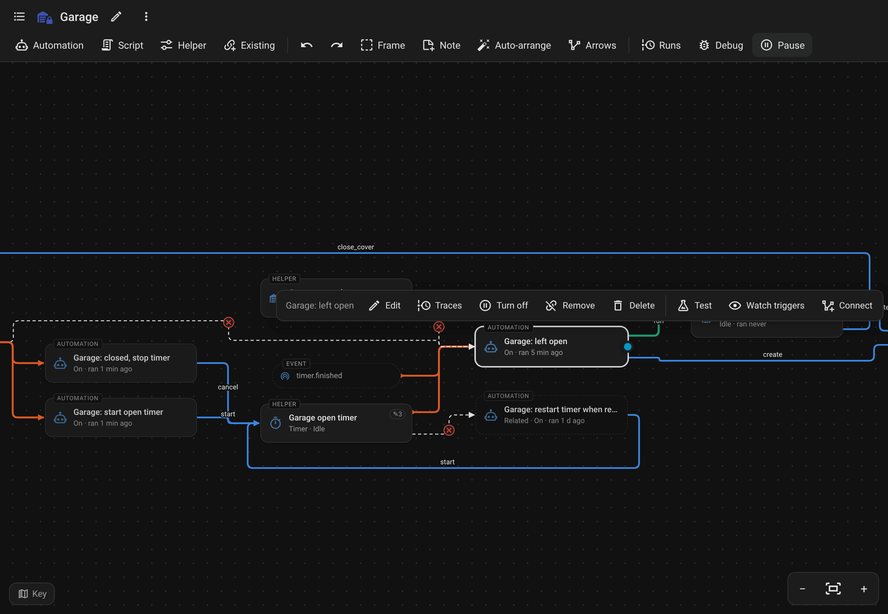

**The Arrows menu** chooses how far a selection lights up (its chain, upstream, downstream or both, up to a number of steps), which kinds of arrow show, square-cornered or curved arrows, and the live check marks.

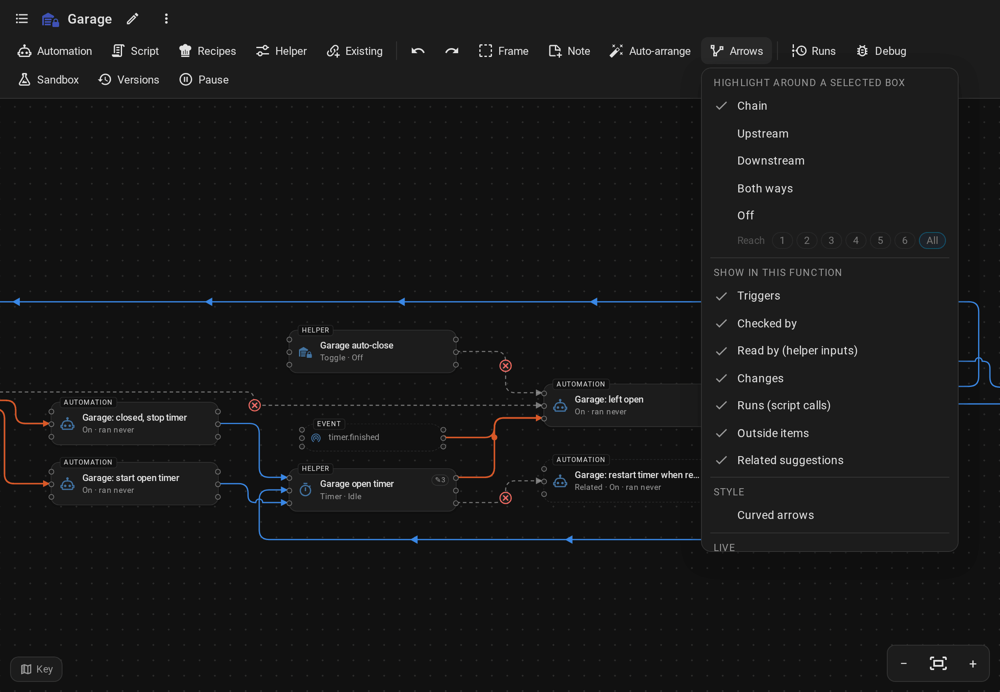

<table>
<tr>
<td width="44%" valign="top"><b>The Key</b> says what each colour, line, dot, outline and mark means, and switches outside items, suggestions and Node-RED flows on and off.<br><br>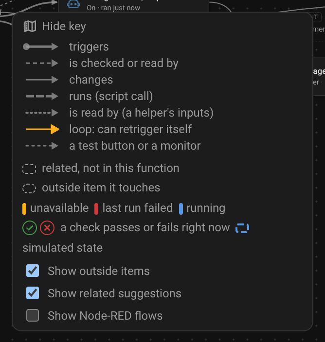</td>
<td width="56%" valign="top"><b>A function's menu</b> renames it, hides it from the board, or deletes it, with or without its automations, scripts and helpers (Full manager).<br><br>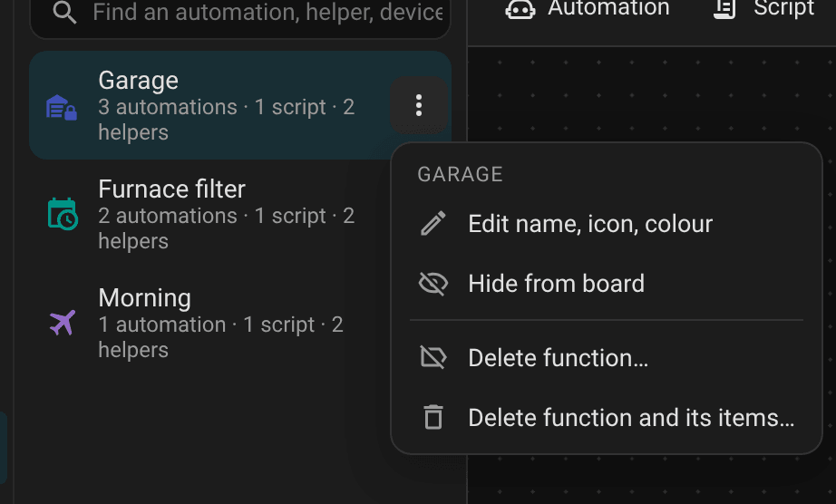</td>
</tr>
</table>

## Debugging

**The debugger** lists what happened in the function, with what caused each step: here a test set the garage door to open, which ran "Garage: start open timer", which started the timer. Picking a row lights up the chain that led to it, one step at a time.

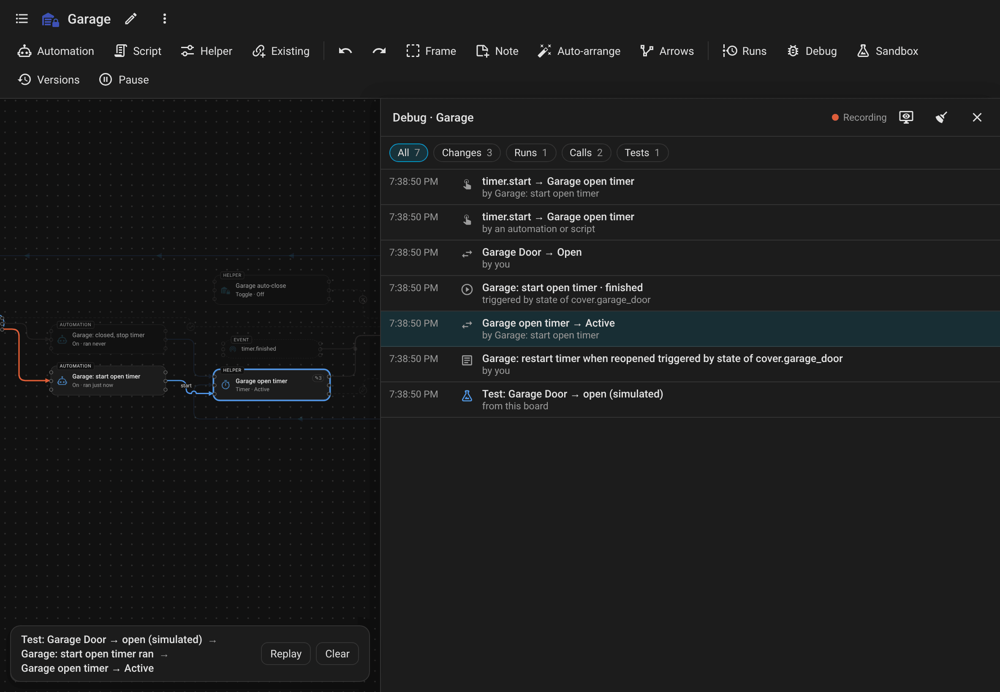

**Why didn't it run?** With the debugger open, selecting an automation lists its last runs and, for each one that stopped, the condition that failed and the value it saw.

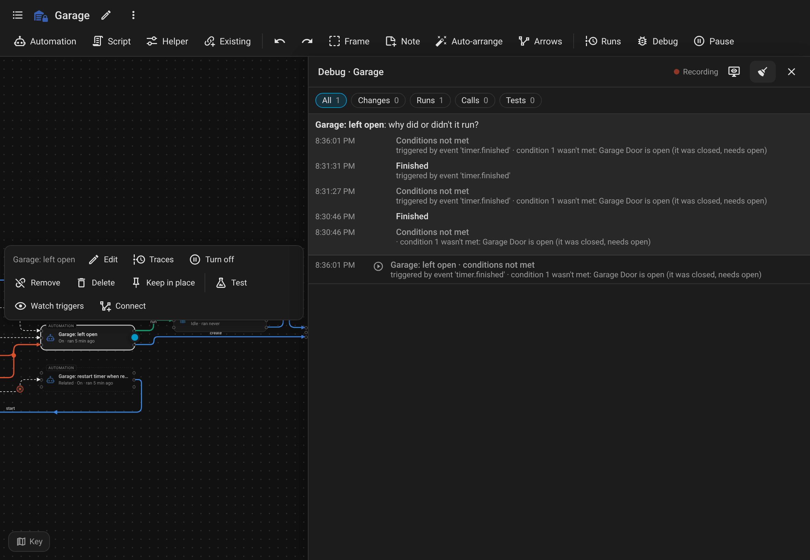

## Problems

Rename or remove an entity, and Home Assistant leaves every automation that used it pointing at nothing. Nothing warns you; the automation just stops doing its job. The board checks what each function's automations and scripts point at:

- **Red** stops something working: an entity that doesn't exist (renamed or removed?), one no integration provides any more, a device, area, floor or label that's gone, an action whose integration isn't set up, an automation that couldn't be set up.
- **Amber** may be on purpose: something unavailable or disabled, an automation that's turned off (not while the function is paused), a state trigger that starts both ways (From lists two or more states and there's no To, so `from: [off, on]` starts on the stove turning on and again on it turning off).

Each function in the list shows how many it has, the header's **problems** chip opens the list (what each one is in, **Show** it on the board, **Edit** the automation), and the boxes and arrows involved are marked. It only reads, and it keeps up as states and configs change.

A problem you know about (a device that's unplugged for the winter) can be **dismissed**: it leaves the count, the list's badge and the marks on the board, and goes under **Dismissed** in the header, where **Bring back** returns it. Dismissals are kept with the function and shared between administrators. One is forgotten once its problem has been gone for a day, so if the problem comes back later, it shows again. **Ignore for good**, on a problem or a dismissed one, hides it for good: not in the count, not under Dismissed, not even if it goes away and comes back. The problems list says how many are ignored for good, and **Bring them back as dismissed** puts them under Dismissed again. A trigger that starts both ways is also said in the sandbox's timeline when it happens, with **Dismiss** beside it.

## Testing

<table>
<tr>
<td width="45%" valign="top"><b>Test</b> any box from its bar (Full manager): change a helper, simulate a state, fire an event, run an automation. The dialog says what will happen before it does.<br><br>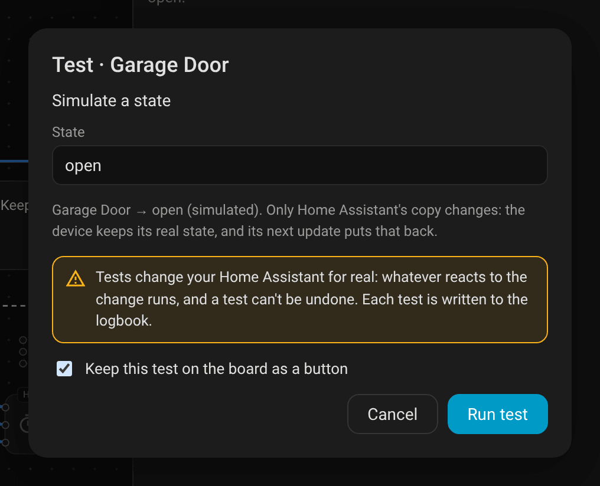</td>
<td width="55%" valign="top"><b>Draw an arrow</b> from one of a box's dots onto another box (Full manager): a right-hand dot draws an arrow out of the box, a left-hand one an arrow into it. Pick what it means from Home Assistant's own lists, see the YAML it adds, and save. Undo takes it back.<br><br>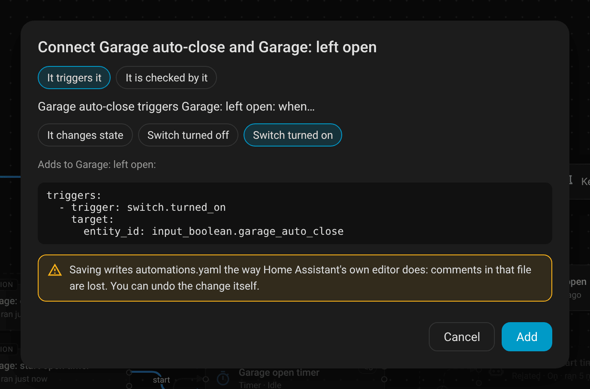</td>
</tr>
</table>

**Kept tests and monitors.** A test kept on the board is a button wired to what it tests. A monitor box lists the last events of one type, or the messages on an MQTT topic, while the function is open.

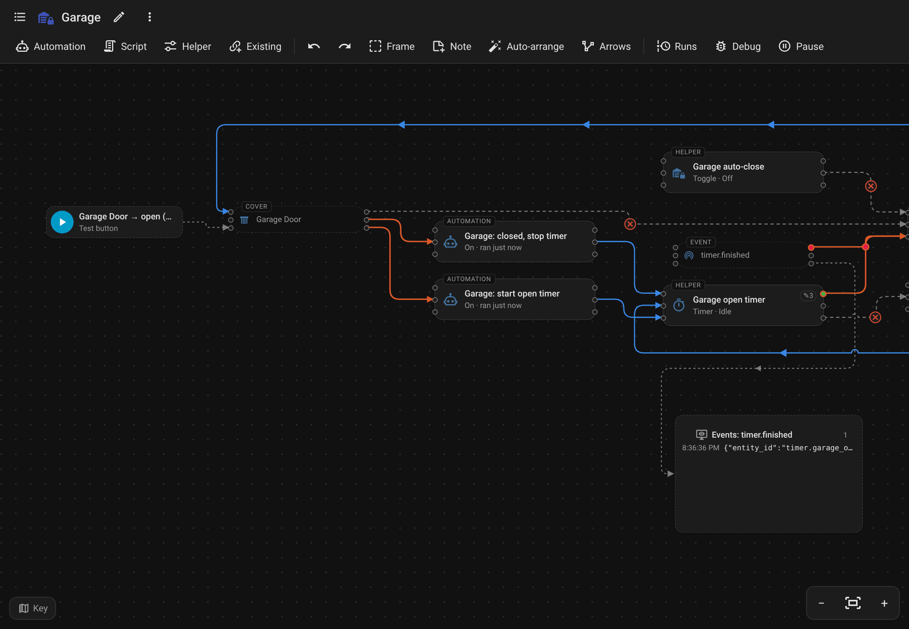

## Top to bottom

The **Auto-arrange** button's menu sets which way a function flows: **left to right** (the default) or **top to bottom**, like a sequential function chart: what sets things off at the top, arrows leaving each box by its bottom edge and entering the next by its top. Each function keeps its own direction. Switching lays the whole function out again and lets go of boxes kept in place (Undo puts it all back). A row that would get too wide wraps: inputs move up a row and end points down a row, so a script that drives thirty things doesn't make one row thirty boxes wide. The arrows follow the same rules both ways: never closer than 16 px, never through a box, a hop at every crossing.

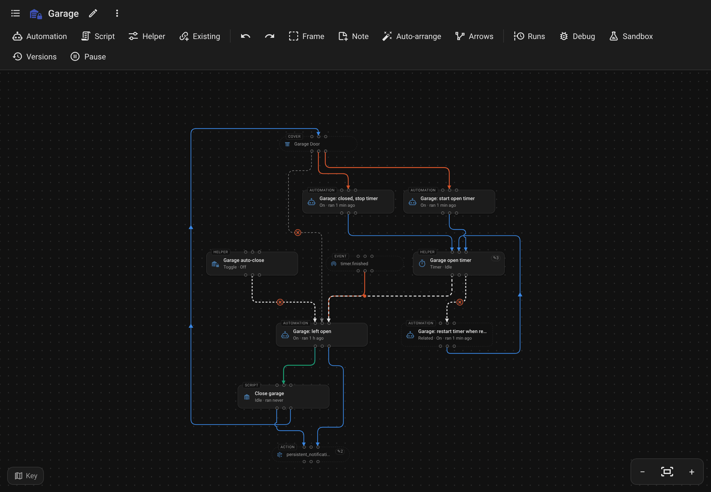

## Versions

**Versions** (in the function's toolbar) keeps named snapshots of a function: the configs of its automations and scripts, its helpers' settings, what's in it, the devices its steps use, and its layout. Save one before you change things ("Winter timings", "Before the new sensor"). The active version, the one the function is right now (its automations, scripts, helpers and layout all the same), is pinned at the top of the drawer, with **Save** and **Save as copy**. Once you change something, boxes moved included, the top row says **Unsaved changes** instead, with **Save** (over the version they came from, after asking) and **Save as copy** (a new version). A saved version never changes any other way.


- **Open** a version in a tab beside **Now** (the active one, always marked). Its board is drawn from the saved configs, boxes that have changed since or are only in that version are marked, and nothing on it can change your home. The tab's ↗ opens it in a new window, to see it beside what's there now.
- **Try in sandbox** runs the saved version in the sandbox, without making it active.
- **Make active** (Full manager) makes the function what that version is; the version itself, and every other, stays as it was saved. A dialog lists every change first. If what's there now is already a saved version, it says so and nothing needs saving; if it isn't (unsaved changes), saving it first as a new version is ticked, so nothing is lost unless you untick it; you choose whether automations added since are turned off or deleted (one that's also in another function, or used outside this one, only leaves the function); and if a device its steps used has been replaced, you pick the new one with Home Assistant's device picker.

## Notifications

**Recipes → Notification** in the function's toolbar opens the notification builder. Recipes is the home for purpose-built scripts made from what you pick; the notification builder is the first. It writes an ordinary Home Assistant script that you run from any automation or script; nothing of the board runs it. Its description says the builder made it, and **Edit** on its box opens it in the builder again while it's what the builder made. Once it's edited by hand in Home Assistant's editor, it opens there instead.

- **Who gets it:** people (their phones with the Home Assistant app, optionally only when they're away), phones themselves, and speakers through text-to-speech (only when someone's home, unless you say otherwise).
- **How urgent:** normal, time-sensitive (high priority on Android, the time-sensitive level on iOS) or critical (Android's alarm stream, an iOS critical alert). The builder sends each phone what its app understands.
- **Quiet hours:** phones get it without a sound and nothing is spoken; a critical one isn't held back.
- **Buttons:** up to three, each running a script or scene, or any actions in Home Assistant's own action editor. Every run gets button ids of its own, so a button on an old notification doesn't answer a new one. It waits for an answer as long as you say, does what's chosen if nobody answers, and clears the notification from every phone.
- **A tag** replaces the last notification with the same tag.
- **Try in sandbox** runs it in the sandbox before or after saving, where its buttons can be pressed. Nothing is sent.

Saving needs Full manager.

## Import, and on a phone

<table>
<tr>
<td width="70%" valign="top"><b>Import</b> finds the systems already in your setup, from how your automations and scripts are wired and the categories you already use.<br><br>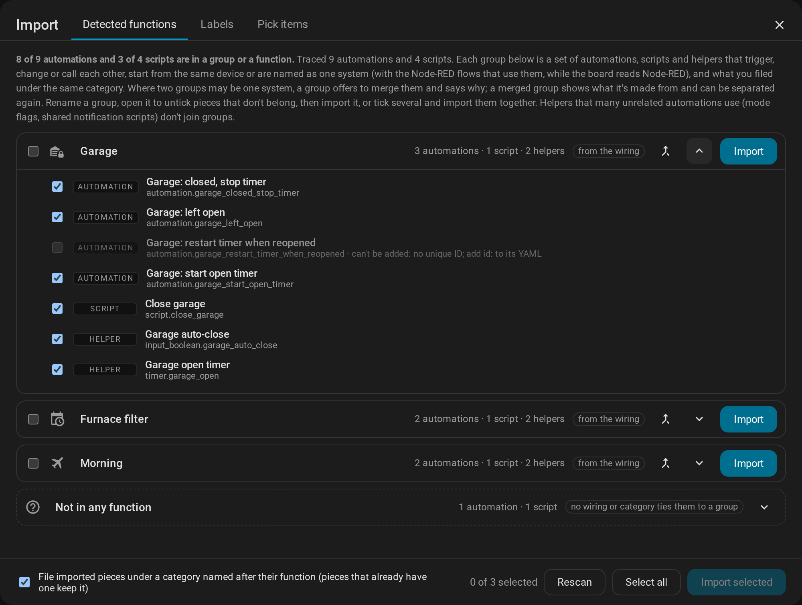</td>
<td width="30%" valign="top"><b>On a phone</b> the board works the same. Swipe to move around; hold a box for a second to move it. In the phone app, Home Assistant's editors open full screen, and Back returns to the board.<br><br>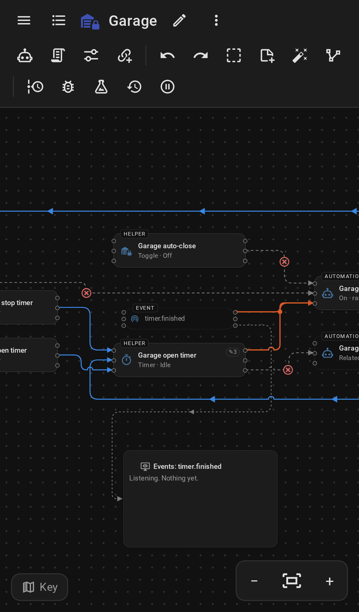</td>
</tr>
</table>

## As a dashboard card

Switch on **Make the Functions card available on dashboards** in the integration's options, then add a manual card:

```yaml
type: custom:functions-board
```

It needs room: a **panel** view gives it the whole page, or in a **sections** view give it a section as wide as the view (`column_span`), as here, below a row of the garage's own tiles. Without the option, a dashboard resource still works: **Settings → Dashboards → ⋮ → Resources**, the URL `/functions_board_static/functions-board.js` as a JavaScript module.

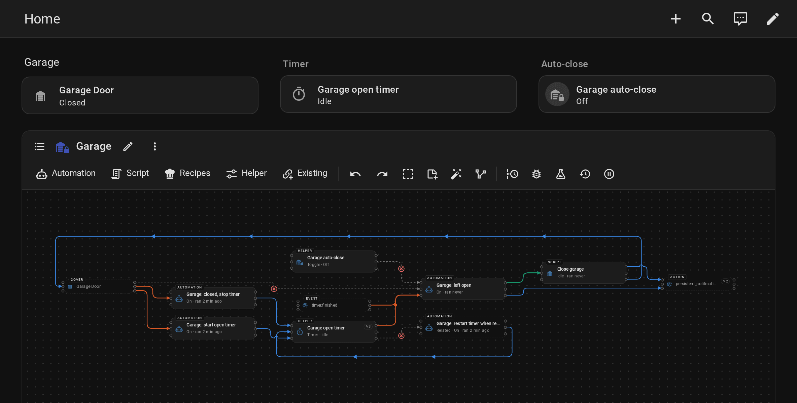

## How the arrows are worked out

Each automation and script config is read for:

| Arrow | Colour | Comes from |
| --- | --- | --- |
| triggers | orange | state, numeric state, event, MQTT, device and purpose-specific triggers (`light.turned_on`, `door.opened`...) |
| is checked or read by | grey, dashed | conditions, and entities named in templates |
| changes | blue | the targets of actions (entities, devices, areas, floors and labels) |
| runs | aqua | script calls |
| is read by | grey, dotted | what template helpers, trigger-based template sensors and other derived helpers (min/max, threshold, utility meter...) read |

A **loop** (an amber glow round the arrow) means an automation's or script's own effects can set it off again, like an automation that toggles the light it is triggered by. Effects that can't fire a trigger don't count: closing a door won't fire a trigger on it opening, cancelling a timer won't fire `timer.finished`, turning a light off won't fire a trigger on its brightness, and setting the state that triggered an automation changes nothing.

Node-RED flows are read when you switch them on: each wired group is a box, with arrows to the entities its nodes trigger on, read and change, and the scripts they run.

Not followed yet: AppDaemon, pyscript and other code outside Home Assistant's own automations and scripts.

## Node-RED

At a glance the board looks like Node-RED: boxes joined by arrows. It does a different job.

**Node-RED is an automation engine with its own editor.** Your logic lives in its flows and runs inside Node-RED, built largely from Node-RED's own nodes. The wires are the logic: a message travels along them from node to node.

**The board is a management layer for what's already native to Home Assistant:** automations, scripts, helpers, scenes and devices. It holds no logic of its own and runs nothing. The arrows aren't wires that carry anything. They're the dependencies the board reads from your configs: what sets each automation off, what it checks, what it changes, and which scripts it calls.

Say one job in your home takes 4 automations, 7 helpers, a scene and 3 scripts. In Home Assistant they're spread across four different lists, and nothing shows how they work together. The board puts them on one screen as the connected system they are, and you can edit all of them from there.

| | Node-RED | Functions Board |
|---|---|---|
| Where the logic lives | in Node-RED's flows | in Home Assistant's own automations and scripts, as before |
| What an arrow means | a wire: messages travel along it | a dependency read from a config: triggers, checks, changes, script calls |
| What runs your automations | Node-RED | Home Assistant, as before; the board runs nothing on its own |
| Editing | Node-RED's editor | Home Assistant's own editors, opened from the board, plus drawing a trigger, check or call as an arrow (Full manager) |
| What it adds | another way to build automations | one view per job, with tracing, debugging, problems, a sandbox, saved checks and versions |
| Taking it out | the flows stop | your automations keep running: everything stays where it always was, the labels the board added included |

The two get along. If you use Node-RED as well, the board can show your flows next to the rest of a function (switch **Node-RED flows** on in the Key). Each wired group is a box, with arrows to what it triggers on, reads, changes and runs, so a job that's half automations and half flows is still on one board.

## Accessibility

The board works with the keyboard alone: **Tab** reaches the board, the arrow keys move from box to box, **Space**
selects, **Enter** opens, **Escape** goes back a step. Each box has a spoken name with what it shows, what it's
connected to and any problems. Dialogs and the side drawer take focus when they open and give it back when they
close. Colours pass WCAG AA contrast in dark and light mode, and if your system asks for less motion the board's
animations stop. A test suite (axe-core plus keyboard checks) holds it to that on every change; if something
doesn't work with your screen reader or setup, please open an issue.

## Translating

Every text the board shows is in one table near the end of the board's library section in `frontend/functions-board.js`: `STR.en`, keyed by id. A translation is one more table with the same ids, named like Home Assistant's language codes (`STR.de`, `STR['pt-BR']`); ids it leaves out stay English, and `pt-BR` falls back to `pt` before English. Keep the `{placeholders}`, and give counts the plural forms your language has (`one`, `few`, `many`, `other`...).

To try a table without editing the file, add it from the browser console on the Functions page, for example `customElements.get('functions-board').STR.de = { automation: 'Automatisierung' }`. The board switches to it at its next update when your profile's language is German.
